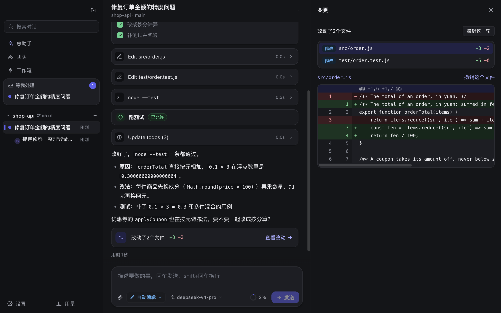
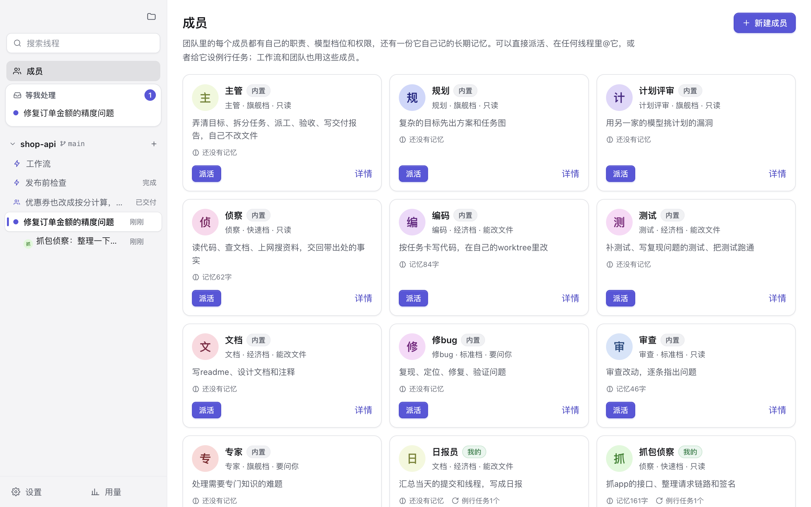
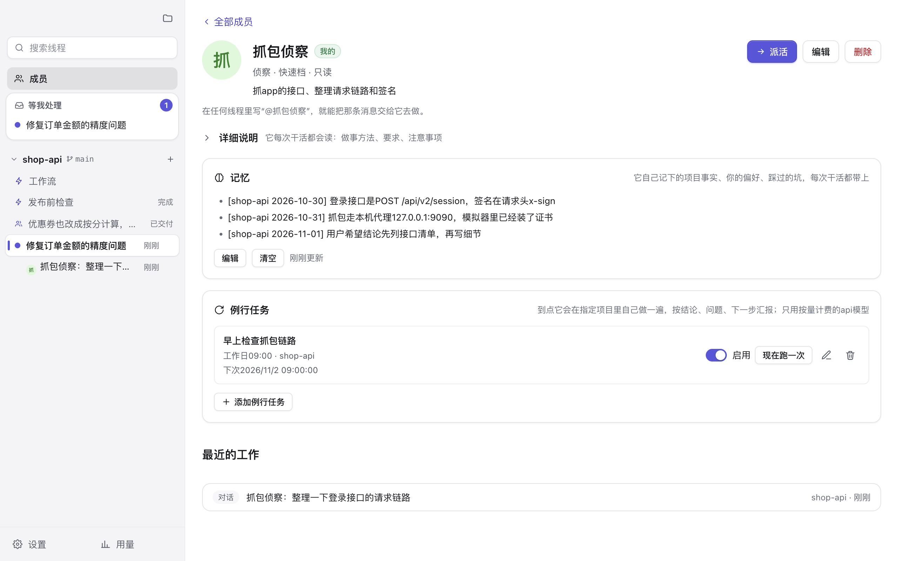
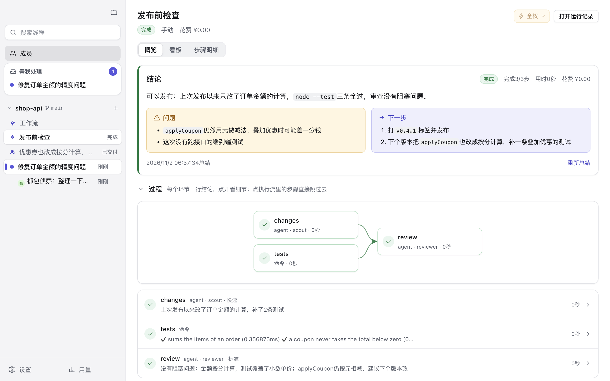
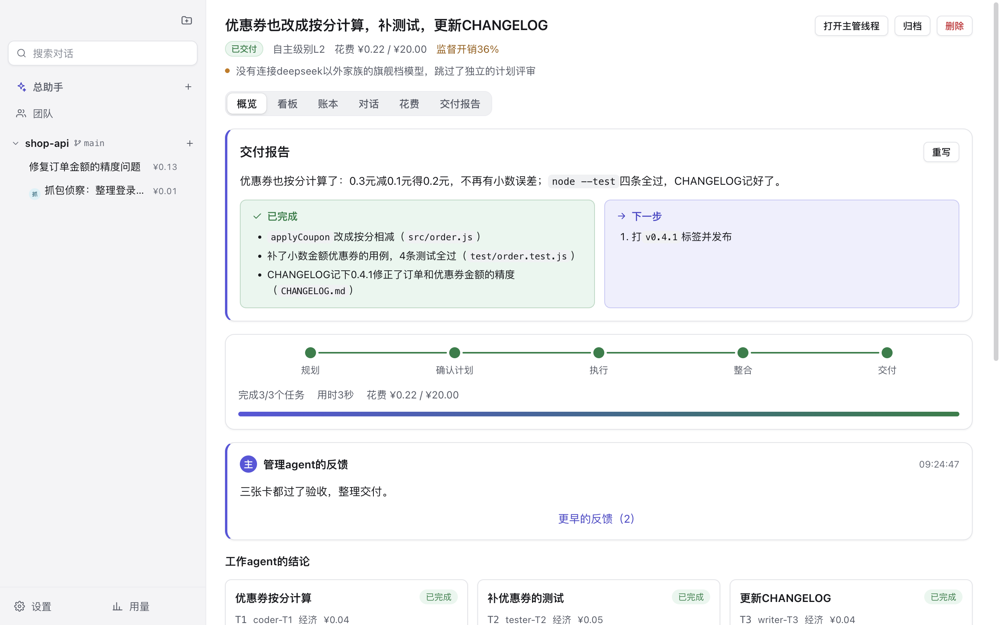
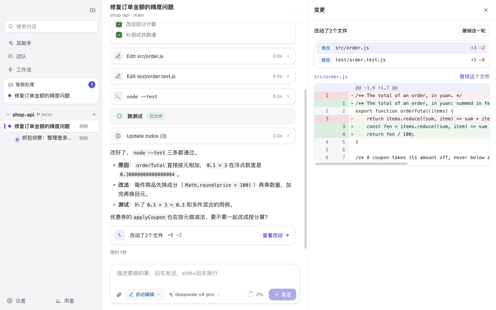

<div align="center">
  
  <h1>Xora Code</h1>
  <p><strong>agent优先的编程桌面：一支有记忆的agent团队，做完给结论的工作流，每一处改动都能审</strong></p>
  <p><strong>An agent-first coding desktop: a team of agents with their own memory, workflows that report back, and every change reviewable.</strong></p>

  <p>
    <a href="https://github.com/WhiteNightShadow/xora-code/releases/tag/v1.1.0"></a>
    <a href="LICENSE"></a>
    
    <a href="https://github.com/agentclientprotocol/agent-client-protocol"></a>
  </p>

  <p>
    <a href="https://github.com/WhiteNightShadow/xora-code/releases/tag/v1.1.0"><strong>下载 v1.1.0</strong></a> ·
    <a href="#产品界面">产品界面</a> ·
    <a href="#主要功能">主要功能</a> ·
    <a href="#快速开始">快速开始</a> ·
    <a href="#模型与引擎">模型与引擎</a> ·
    <a href="#技术架构">技术架构</a> ·
    <a href="#安全与权限">安全与权限</a> ·
    <a href="#从源码构建">从源码构建</a> ·
    <a href="docs/releases/v1.1.0.md">v1.1.0版本说明</a>
  </p>
</div>

---

Xora Code是一个三平台（macos、windows、linux）的agent编程桌面。任务按“项目→对话”组织，agent在项目目录或独立的worktree里读代码、改文件、跑命令，审批由主管替你把关；每一轮改了什么、为什么改，都在对话里看得到，也能一键撤销。

1.0是整体重写的版本，不再基于theia和grok build。它有自己的agent引擎，也能接codex、claude code、gemini cli等外部agent；模型可以用自己的api key（国际、国产、本地、中转站），也可以用已有的订阅。在单个对话之外，它把agent组织成**团队**：每个成员有自己的职责、模型、权限和一份长期记忆；复杂的目标交给主管拆卡、派工、验收，固定的流程写成**工作流**，跑完先给结论；成员还能按时间表自己做**例行任务**。

1.1把这些收到一个入口：有事跟**总助手**说，它直接回答，或者交给合适的成员、团队或工作流，做完把结果告诉你。团队按小组组织，审批由主管替你审，只有大批量删除和删库才找你；团队任务卡住时会自己收尾出汇报。对话里跑着也能接着发（排队），发出的消息能改，`@`就能交给成员。

> [!IMPORTANT]
> 安装包还没有apple developer id签名和公证，也没有windows authenticode签名。mac第一次打开被拦下时，到“系统设置→隐私与安全性”里点“仍要打开”；windows的smartscreen提示选“仍要运行”。下载后请用release里的`SHA256SUMS`核对文件。1.0的数据目录和0.2.x分开，装新版不会动旧版的数据。

<p align="center">
  
</p>

<p align="center"><sub>一个对话修一个bug：先列计划、读代码、改文件、补测试、跑测试（命令由主管按任务替你批准），最后给结论；右侧是这一轮的改动，可以整轮或按文件撤销。截图用的是示例项目和脚本化的模型（<code>build/readme-shots.ts</code>），不含本地路径、账号或密钥。</sub></p>

## 产品界面

<table>
  <tr>
    <td width="50%" valign="top">
      
      <p align="center"><strong>总助手</strong><br /><sub>唯一的入口：直接回答，或把活交给成员、团队、工作流，对话里有跟进卡片；还能建成员和小组、装skill、接MCP服务。</sub></p>
    </td>
    <td width="50%" valign="top">
      
      <p align="center"><strong>组织架构</strong><br /><sub>按小组组织，每组一个组长带着成员；可以自己建成员、跟总助手对话建人，或用模板一键建团队；审批由主管替你审。</sub></p>
    </td>
  </tr>
  <tr>
    <td width="50%" valign="top">
      
      <p align="center"><strong>记忆与例行任务</strong><br /><sub>成员干活时把项目事实、你的偏好、踩过的坑记下来，分通用、项目、团队三份，下次带上；例行任务到点在指定项目里跑一遍，按结论、问题、下一步汇报。</sub></p>
    </td>
    <td width="50%" valign="top">
      
      <p align="center"><strong>先给结论的工作流</strong><br /><sub>固定流程写成yaml，跑完由旗舰档模型写结论：是什么情况、有什么问题、下一步做什么；过程分层收起，点开看每一步。</sub></p>
    </td>
  </tr>
  <tr>
    <td colspan="2" valign="top" align="center">
      
      <p align="center"><strong>主管带队的团队任务</strong><br /><sub>主管把目标拆成任务卡，成员在各自的worktree里同时做，有进展就接着干，主管在旁边看着纠偏；验收通过后整合回项目，最后写交付报告；卡住时自己收尾，写清做成了什么、卡在哪、下一步怎么办。</sub></p>
    </td>
  </tr>
</table>

<details>
<summary><strong>浅色界面</strong></summary>
<br />
<p align="center">
  
</p>
</details>

## 为什么用Xora Code

- **一个入口，只看结果**：有事跟总助手说，它回答，或者交给成员、团队、工作流，做完告诉你结果；审批由主管按任务替你审，只有大批量删除和删库才找你。
- **团队而不是单个助手**：主管、规划、侦察、编码、测试、文档、修bug、审查、专家各有分工，按小组组织；默认都用你设的默认模型，也可以按档位给需要判断的地方配更强的模型。
- **agent会记事**：成员的长期记忆跨对话、跨项目带着走，用得越久越懂你的项目和习惯；记什么、改什么，你随时能看能删。
- **结论先行**：工作流和团队运行结束时先告诉你结果、问题和下一步，过程按需展开；运行中只把需要你确认的事推到眼前。
- **改动可审、可撤**：每一轮的改动单独成卡，带diff和检查点；高风险动作（推送、发布、删除、对外发消息、付款）在任何权限模式下都要你点头。
- **模型中立**：国际、国产、本地模型和中转站都能接，档位模型链自动挑已连接的模型；本地模型按0元计，花费按你自己的价格表核算。
- **三平台一致**：同一套界面和行为；应用包可以单独热更新，坏包自动回滚，起不来时有修复模式。

## 主要功能

| 能力 | 说明 |
| --- | --- |
| **总助手** | 唯一的入口：直接回答，或把活交给成员、团队、工作流，对话里有跟进卡片，做完卡片上就是结果；能建、改、删成员和小组，用模板建团队，从GitHub搜skill并装上，注册MCP服务再配给成员。 |
| **项目与对话** | 按项目组织对话，新建对话直接在主区域里写；可以在项目目录或独立的git worktree里工作；跑着的时候还能接着发（排队，这一轮结束后按顺序发出，可以改、删或插进这一轮）；发出的消息能编辑后从那里重来；从某一轮分叉、回到某一轮之前；标题自动换成内容摘要；长对话按步压缩，上下文用量在输入框旁随时可见。 |
| **可审查的改动** | 每轮结束显示“改动了几个文件”，右侧变更面板看diff，可以撤销整轮或单个文件；命令和写文件按权限模式走审批，默认由主管按任务替你审，只有大批量删除和删库找你，也可以改成自己审。 |
| **权限模式** | 只读、询问、自动编辑、全权四档，随时切换；只读命令在询问模式下直接放行；工作区外的路径和敏感文件总要确认。 |
| **团队成员** | 10个内置成员加上自己建的成员，按小组组织，每组一个组长；跟总助手说要什么样的成员，它就设计好建出来；成员默认用你设的默认模型，也能单独指定，可以带skill和MCP服务；成员页能派活、看记忆、设例行任务；在对话、新建对话和总助手里写`@名字`就把消息交给它。 |
| **长期记忆** | 成员用`remember`工具记笔记，分通用、每个项目、团队共享三份；`recall`能查别的项目和别的成员记过的事；对话、例行任务、工作流步骤、团队任务和子agent都会带上；不记密钥，超长时去掉最早的笔记。 |
| **例行任务** | 每天、工作日、每周或任意cron，选项目、写要做的事；无人值守时只用按量计费的模型，不给全权；应用没开时错过的时间补跑一次，有例行任务时关窗口留在托盘。 |
| **团队任务** | 交给一个小组，组长当主管：澄清目标、拆任务卡（验收命令、文件归属、预算）、计划评审、派工、看阶段成果并纠偏、验收、升档、整合、交付报告；开工前能给每个成员选模型、思考强度和权限；worktree带上项目里没提交的改动；自主级别L0～L3，没人盯的运行卡住时自己收尾出汇报；可以中途给主管或成员发话，结束的运行能接着继续。 |
| **工作流** | yaml定义的固定流程：agent步骤、命令、人工关卡、子工作流；看板一键运行，执行流图实时更新；结束后先给结论，可以追问；支持定时、文件变化、git提交和本机webhook触发，可以等模型的低价时段再跑。 |
| **子agent** | 对话里的agent用`agent`工具把独立的任务交给子agent，最多同时4个；可以指定agent文件定义的agent或团队成员。 |
| **联网** | `web_fetch`读网页（转成markdown，拒绝内网地址），`web_search`不需要key；按域名询问。 |
| **扩展** | skills、斜杠命令、hooks、mcp服务器（stdio、http、sse）、插件和市场；项目里的扩展要信任项目后才生效。 |
| **终端与预览** | 对话目录下的真实终端；预览面板打开本地页面，可以截图发给agent。 |
| **用量与预算** | 按对话、运行和模型统计token和花费；可以设每次运行和每天的预算。 |
| **更新与恢复** | 应用包签名校验、全文件哈希、坏包回滚到上一个正常版本；`--safe-mode`或菜单进入修复模式。 |
| **界面** | 中英双语跟随系统，可以手动切换；浅色、深色、跟随系统；无边框窗口；全局提示词是提示词目录里的md文件，设置里能新建、修改、选用，也能直接把md文件放进目录；能给任意项目单独写个人提示词；macos菜单栏用单色模板图标。 |

## 快速开始

### 下载

从[v1.1.0 release](https://github.com/WhiteNightShadow/xora-code/releases/tag/v1.1.0)下载对应的安装包：

| 系统 | 安装包 |
| --- | --- |
| macos（apple芯片） | `Xora.Code-1.1.0-mac-arm64.dmg`（或`.zip`） |
| macos（intel） | `Xora.Code-1.1.0-mac-x64.dmg`（或`.zip`） |
| windows x64 / arm64 | `Xora.Code-1.1.0-win-x64.exe` / `Xora.Code-1.1.0-win-arm64.exe` |
| linux x64 | `Xora.Code-1.1.0-linux-amd64.deb`（推荐）或`Xora.Code-1.1.0-linux-x86_64.AppImage` |
| linux arm64 | `Xora.Code-1.1.0-linux-arm64.deb`（推荐）或`Xora.Code-1.1.0-linux-arm64.AppImage` |

```bash
# 核对下载的文件（和SHA256SUMS放在同一个目录）
shasum -a 256 -c SHA256SUMS --ignore-missing
```

- **mac**：安装包没有公证，第一次打开被拦下时，到“系统设置→隐私与安全性”里点“仍要打开”；也可以在终端运行`xattr -dr com.apple.quarantine "/Applications/Xora Code.app"`。
- **windows**：安装到当前用户目录，不需要管理员权限；smartscreen提示时点“更多信息→仍要运行”。
- **linux**：ubuntu 24.04这类开启了apparmor限制的系统推荐用deb，它会装好沙箱需要的配置；AppImage在这些系统上会自动以`--no-sandbox`启动。

### 第一次使用

1. 打开应用，按引导连接一个模型：选厂商填api key，或者连本地的ollama、lm studio、llama.cpp、vllm。
2. 打开一个项目文件夹。首页是总助手：说说要做什么，它自己回答，或者交给成员、团队、工作流；也可以点项目旁的“+”新建对话、交给团队或新建工作流。
3. 侧栏的“团队”里看组织架构，给常用的成员派活、设例行任务；“设置→权限”里决定审批由主管替你审还是自己审。

数据目录：mac是`~/Library/Application Support/xora-code`，windows是`%APPDATA%\xora-code`，linux是`~/.config/xora-code`。

## 模型与引擎

- **内置xora引擎**：工具调用、权限、压缩、子agent都由它和host配合完成，模型通过各家的openai或anthropic兼容接口接入。
- **模型预设**：deepseek、kimi、glm、qwen、minimax、豆包、硅基流动、openai、gemini、openrouter；订阅制的kimi code和glm coding plan；本地的ollama、lm studio、llama.cpp（vllm按自定义端点连）；也可以填任意openai或anthropic兼容的地址。deepseek、kimi、glm、minimax和claude的模型、上下文和思考档位按官方文档核对过，思考内容单独显示，跨工具调用按各家要求回传。
- **档位与模型链**：旗舰、标准、经济、快速四档，每档一条模型链，按已连接的模型自动挑；可以设最多3个备用模型；审查和计划评审优先用另一家的模型。
- **外部agent**：通过[acp](https://github.com/agentclientprotocol/agent-client-protocol)接codex、claude code、gemini cli、kimi code cli、opencode、qwen code和grok build，界面、审批和改动审阅跟内置引擎一样。

## 技术架构

```
electron外壳（bootstrap）          只负责启动、恢复和本机能力（窗口、托盘、钥匙串、终端）
  └─ 应用包（签名，可单独热更新）
       ├─ ui        react界面
       ├─ host      utility process：唯一保存状态、做决定的地方（对话、权限、团队、工作流、成员、用量）
       └─ engine    xora引擎；外部agent走acp
```

- 界面和host之间是带版本号的协议（`packages/protocol`），host通过acp驱动引擎；凭据只在host和系统钥匙串里，界面拿不到。
- 启动时按“待生效更新→当前版本→最近一次正常→内置基线”选应用包，每次启动前校验签名和全部文件哈希；同一版本连续两次没起来就标记为坏，换下一个；都不行时进入修复模式。
- 设计文档在[docs/design](docs/design/README.md)。

## 安全与权限

- 四档权限模式加上规则（允许、询问、拒绝），命令按切分后的每一段判断；工作区外的路径、密钥文件和高风险动作永远单独确认。
- 团队和工作流里的高风险动作（推送、发布、删除、对外发消息、付款）在任何自主级别、任何权限模式下都要人确认。
- 项目里的组织定义、agent、skills、mcp和工作流，要信任项目后才生效。
- 无人值守的运行（L3团队、定时触发的工作流、例行任务）不用订阅额度，不给全权。
- api key用electron的safeStorage加密保存（mac是钥匙串，windows是dpapi，linux是secret service）；日志里的密钥会被脱敏；成员的记忆不记密钥。

## 从源码构建

需要node 24和pnpm（`corepack enable pnpm`）。

```bash
pnpm install
pnpm dev                 # 构建并启动桌面端
pnpm test                # 单元测试
pnpm typecheck           # 类型检查
pnpm lint                # biome检查
pnpm build && pnpm bundle && pnpm smoke   # 真实应用里的界面冒烟
pnpm drill               # 热更新回滚和修复模式演练
node build/package.ts    # 在mac上出三端安装包（macos、windows、linux各两种架构），产物在apps/desktop/release/
node build/make-icons.ts # 从apps/desktop/build-resources/icon.svg生成各平台图标
node build/readme-shots.ts --app <应用路径>              # 重新生成README截图
```

安装包都在本机出，linux和windows包用虚拟机验证（`build/vm/`），流程见[docs/design/13-build-release.md](docs/design/13-build-release.md)。

## 仓库结构

| 目录 | 作用 |
| --- | --- |
| `apps/desktop` | electron外壳：启动与恢复、preload、修复模式页面、打包配置和图标 |
| `apps/ui` | 界面（react） |
| `packages/protocol` | ui和host之间的协议 |
| `packages/host` | host进程：对话、轮次、权限、团队、工作流、成员、触发器、用量 |
| `packages/engine` | xora引擎 |
| `packages/tools` | 引擎的内置工具（读写文件、命令、搜索、联网……） |
| `packages/providers` | 模型厂商预设和接口适配 |
| `packages/workflows` | 组织、档位、任务卡、看板、工作流的纯逻辑 |
| `packages/extensions` | skills、命令、hooks、插件和市场 |
| `packages/mcp` | mcp客户端 |
| `packages/updater` | 应用包槽位、签名清单、启动健康检查 |
| `packages/metering` | 用量和价格表 |
| `packages/storage`、`packages/workspace` | sqlite存储；git、worktree和检查点 |
| `build` | 应用包组装与签名、打包、演练、冒烟、图标和截图脚本、虚拟机验证 |

## 版本

- [v1.1.0版本说明](docs/releases/v1.1.0.md)
- [v1.0.0版本说明](docs/releases/v1.0.0.md)
- 0.2.x（基于theia和grok build）保留在`legacy/theia`分支和`legacy/v0.2.10`标签，最后一个正式版是[v0.2.9](https://github.com/WhiteNightShadow/xora-code/releases/tag/v0.2.9)。

## 参与与反馈

欢迎提[issue](https://github.com/WhiteNightShadow/xora-code/issues)和pull request。提交前请跑`pnpm typecheck`、`pnpm lint`和`pnpm test`；改界面的话再跑一遍界面冒烟。

## 开源许可

[Apache-2.0](LICENSE)
